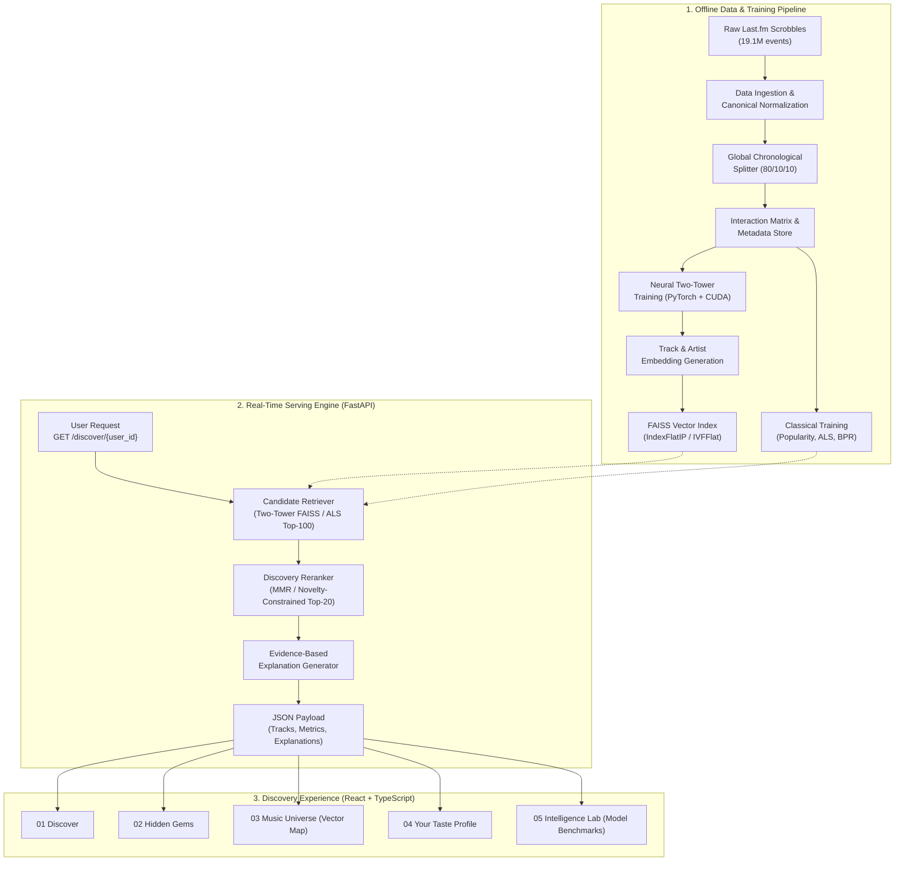

# EUTERPE — System Architecture & Product Engineering Specification
**Version:** 1.0.0  
**Phase:** 0 — Scientific Specification and Research Foundation  
**System:** EUTERPE — The Intelligent Music Discovery Engine  

---

## 1. High-Level Architecture Overview

EUTERPE is partitioned into three interconnected engines:
1. **Recommendation Intelligence:** Scalable candidate generation capturing historical listening preferences.
2. **Discovery Intelligence:** Diversity-aware, constraint-guided ranking expanding long-tail musical exposure.
3. **Music Discovery Experience:** High-performance serving API and explainable, interactive web interface.



---

## 2. Component Specifications

### 2.1 Component 1: Data Engineering & Normalization (`src/euterpe/data`)
* **`ingestion.py`:** Handles streaming extraction, parsing of tab-separated files, and fast conversion into Arrow/Parquet tables via Polars.
* **`normalization.py`:** Implements deterministic string canonicalization, stripping remaster/live noise, handling multilingual UTF-8 strings, and generating reproducible integer mapping dictionaries (`user_id -> int`, `track_key -> int`, `artist_key -> int`).
* **`splitting.py`:** Executes strict global chronological cutoffs, evaluates warm/cold user eligibility, and persists test ground truth sets.

### 2.2 Component 2: Models & Neural Retrieval (`src/euterpe/models`)
* **`classical/als.py`:** Fast CPU/GPU matrix factorization via `implicit.als.AlternatingLeastSquares`.
* **`classical/bpr.py`:** Pairwise Bayesian Personalized Ranking baseline.
* **`neural/two_tower.py`:** PyTorch dual-encoder model:
  * User Tower: Projects user scrobble history and profile features into $\mathbb{R}^{64}$.
  * Track Tower: Projects track and artist embeddings with LayerNorm and GELU activations.
* **`neural/retrieval.py`:** FAISS vector database wrapper for sub-5ms exact and approximate inner-product neighbor retrieval.

### 2.3 Component 3: Discovery Science Engine (`src/euterpe/discovery`)
* **`metrics.py`:** Mathematical reference implementations of $\text{Recall}@K$, $\text{NDCG}@K$, $\text{Novelty}@K$, $\text{ILD}$, $\text{Catalog Coverage}$, $\text{Gini}$, and $\text{Serendipity}$.
* **`reranking.py`:** MMR and discovery-constrained rerankers operating on candidate vectors and relevance scores.
* **`segmentation.py`:** Profiles listeners into mainstream, niche, specialist, and exploratory cohorts.

### 2.4 Component 4: High-Performance Serving API (`src/euterpe/api`)
Built on FastAPI with Pydantic schemas:
* `GET /health` — Service readiness and loaded model artifact status.
* `GET /recommendations/{user_id}?k=20` — Standard personalized CF recommendations.
* `GET /discover/{user_id}?k=20&policy=mmr&lambda_param=0.6` — Discovery-reranked recommendations.
* `GET /hidden-gems/{user_id}?k=20&max_popularity=0.05` — High-relevance long-tail tracks.
* `GET /users/{user_id}/taste` — Longitudinal profile, diversity index, and top artist affinities.
* `GET /explanations/{user_id}/{track_id}` — Evidence-based justification (no hallucinations).
* `GET /universe/embeddings?sample=500` — Projected 2D coordinates for visual universe exploration.
* `GET /metrics/benchmark` — Live offline benchmark metrics and Pareto curves.

### 2.5 Component 5: Explainable Music Experience (Frontend)
Designed with a luxury dark aesthetic:
* **Palette:**
  * **Obsidian:** `#0B0C10` (Background primary)
  * **Deep Charcoal:** `#1F2833` (Card and panel backgrounds)
  * **Royal Violet:** `#6C22D6` (Primary accent, intelligence highlights)
  * **Metallic Gold:** `#FFB800` (Discovery gems, high-novelty markers)
  * **Soft Silver:** `#C5C6C7` (Typography secondary, metadata labels)
* **Experiences:**
  1. **Discover:** Personalized listening feed blending familiarity with controlled discovery.
  2. **Hidden Gems:** Long-tail exploration showcasing unheralded tracks aligned with taste.
  3. **Music Universe:** Interactive 2D scatter plot of tracks in latent embedding space.
  4. **Your Taste:** Interactive radar and bar charts revealing listening diversity and genre breadth.
  5. **Intelligence Lab:** Research dashboard displaying comparative metrics, Pareto frontiers, and Gini exposure curves.

---

## 3. Evidence-Based Explanation Protocol

EUTERPE strictly prohibits black-box or fabricated explanations. Every recommendation explanation is decomposed into mathematically verified components:

```json
{
  "track_id": 4821,
  "track_name": "Parolibre",
  "artist_name": "Ryuichi Sakamoto",
  "predicted_relevance": 0.884,
  "novelty_score": 11.42,
  "explanation": {
    "primary_signal": "ARTIST_AFFINITY",
    "details": "You have listened to Ryuichi Sakamoto 47 times across 6 distinct sessions.",
    "similar_to_history": [
      {"track_name": "Merry Christmas Mr. Lawrence", "similarity": 0.82}
    ],
    "discovery_attribute": "Deep Cut (Bottom 15% of artist catalog listens)",
    "intra_list_contribution": "Increases acoustic variety in ambient/classical piano"
  }
}
```
