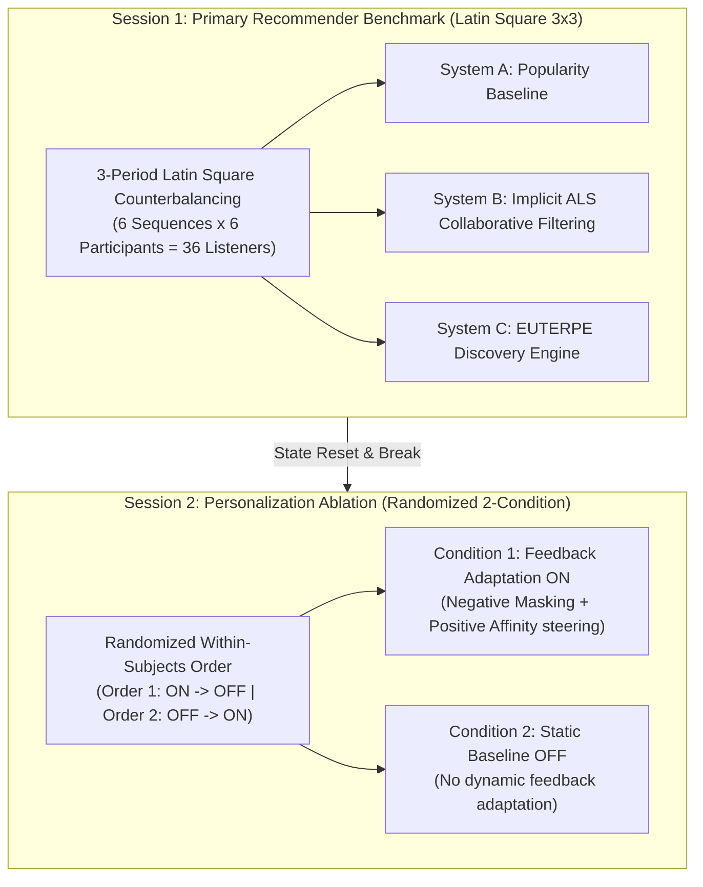

# EUTERPE Phase 7B (v1.1) — Prospective Human Listener Study Protocol

**Protocol Document ID:** EUTERPE-PROTO-7B-V1.1-FROZEN  
**Status:** Scientifically Amended, Pre-Registered & Authorized for Human Recruitment  
**Principal Investigator:** Dev Mehta & Antigravity Discovery Research Team  
**Date of Ratification:** 2026-11-24  
**Target Gate:** Phase 7B Feasibility Pilot & Pre-Registered Human Discovery Evaluation  

---

## 1. Executive Summary & Methodological Demarcation

### 1.1 Strict Demarcation from Phase 7A Offline Replay
The prior Phase 7A milestone evaluated a 100-listener historical Last.fm scrobble cohort. In accordance with senior scientific review:
- Historical listening records from 2008 do not capture active human discovery intent, real-time auditory appraisal, or subjective serendipity.
- A future scrobble is not an explicit Like.
- Offline bootstrap confidence intervals ($PDR$ diff $[-3.20\%, +3.91\%]$) failed the $-2.5\%$ non-inferiority margin and were formally certified as **`INCONCLUSIVE / NOT ESTABLISHED`**.

**Phase 7B is the authorized prospective human listener trial.** It deploys active human participants evaluating counterbalanced slates in real time, accompanied by 30-second audio preview playback, explicit 2D familiarity/preference feedback, and open-ended qualitative assessment.

---

## 2. Participant Stratification & Power Qualification

### 2.1 Feasibility Pilot Designation ($N=36$)
- **Sample Allocation:** $N = 36$ active human listeners.
- **Stratified Activity Tiers:**
  1. **Sparse Listeners ($Q1$, $n = 12$):** Monthly volume $\le 50$ scrobbles. Evaluates discovery under severe interaction sparsity.
  2. **Medium Listeners ($Q2-Q3$, $n = 12$):** Monthly volume between 50 and 300 scrobbles. Evaluates mainstream recommendation balance.
  3. **Heavy Listeners ($Q4$, $n = 12$):** Monthly volume $> 300$ scrobbles. Evaluates escape from popularity head saturation.

### 2.2 Explicit Power Qualification (Issue B Resolution)
> [!IMPORTANT]
> **Statistical Power Caveat:**  
> The $N = 36$ sample size provides $85\%$ power to detect a conventional medium paired effect size ($d = 0.50$) at two-tailed $\alpha = 0.05$.  
> **However, testing the primary non-inferiority margin ($\delta = -2.5\%$) on $PDR_{\text{conditional}}$ against ALS may be potentially underpowered** due to bounded binomial response distributions, participant-level clustering, and unfamiliarity filtering.  
> Therefore, $N = 36$ is formally designated as a **Feasibility Pilot Cohort**. The measured pilot variance, within-participant correlation, and response distributions will be used to definitively power the subsequent confirmatory study. No definitive claim of proven non-inferiority will be made if confidence bounds are wide.

---

## 3. Disambiguated Discovery Endpoints & Denominators (Issue A Resolution)

To resolve metric denominator ambiguity, Phase 7B pre-registers distinct mathematical formulations for conditional discovery rates and overall product yields:

```
                                  DISCOVERY METRIC TAXONOMY
          +-----------------------------------------------------------------------+
          |                                                                       |
          v                                                                       v
[ CONDITIONAL METRICS (Primary Science) ]             [ YIELD METRICS (Product Economics) ]
Denominator: Unknown Evaluated Impressions            Denominator: Total Impressions Presented
Measures: Quality of unfamiliar music                Measures: Overall discovery throughput
```

### 3.1 Primary Pre-Registered Endpoint: Conditional Positive Discovery Rate ($PDR_{\text{conditional}}$)
Measures the probability that an unfamiliar recommendation satisfies the listener:

$$PDR_{\text{conditional}} = \frac{|\{i \in \text{Impressions} : \text{Familiarity}_i = \text{UNKNOWN} \land \text{Preference}_i = \text{POSITIVE}\}|}{|\{i \in \text{Impressions} : \text{Familiarity}_i = \text{UNKNOWN} \land \text{Preference}_i \ne \text{UNSPECIFIED}\}|} \times 100\%$$

### 3.2 Secondary Product Yield: Positive Discovery Yield ($PDR_{\text{yield}}$)
Measures how many recommendation slots in a slate produce a novel hit:

$$PDR_{\text{yield}} = \frac{|\{i \in \text{Impressions} : \text{Familiarity}_i = \text{UNKNOWN} \land \text{Preference}_i = \text{POSITIVE}\}|}{|\text{Total Impressions Presented}|} \times 100\%$$

### 3.3 Saved Discovery Yield ($SDR_{\text{yield}}$) — Investigative Intent
Tracks tracks saved for later exploration, reported **strictly separately from immediate musical liking**:

$$SDR_{\text{yield}} = \frac{|\{i \in \text{Impressions} : \text{Familiarity}_i = \text{UNKNOWN} \land \text{Preference}_i = \text{SAVE\_FOR\_LATER}\}|}{|\text{Total Impressions Presented}|} \times 100\%$$

$$SDR_{\text{conditional}} = \frac{|\{i \in \text{Impressions} : \text{Familiarity}_i = \text{UNKNOWN} \land \text{Preference}_i = \text{SAVE\_FOR\_LATER}\}|}{|\{i \in \text{Impressions} : \text{Familiarity}_i = \text{UNKNOWN} \land \text{Preference}_i \ne \text{UNSPECIFIED}\}|} \times 100\%$$

### 3.4 Conditional Rejection Rate ($RDR_{\text{conditional}}$)
Measures how frequently novel recommendations fail listener taste:

$$RDR_{\text{conditional}} = \frac{|\{i \in \text{Impressions} : \text{Familiarity}_i = \text{UNKNOWN} \land \text{Preference}_i = \text{NEGATIVE}\}|}{|\{i \in \text{Impressions} : \text{Familiarity}_i = \text{UNKNOWN} \land \text{Preference}_i \ne \text{UNSPECIFIED}\}|} \times 100\%$$

### 3.5 Conditional True Serendipity ($SHR_{\text{conditional}}$)
$$SHR_{\text{conditional}} = \frac{|\{i \in \text{Impressions} : \text{Familiarity}_i = \text{UNKNOWN} \land \text{Preference}_i \in \{\text{POSITIVE}, \text{SAVE\_FOR\_LATER}\}\}|}{|\{i \in \text{Impressions} : \text{Familiarity}_i = \text{UNKNOWN} \land \text{Preference}_i \ne \text{UNSPECIFIED}\}|} \times 100\%$$

---

## 4. Experimental Structure & State Isolation (Issue C Resolution)

To prevent order and fatigue confounds, the study decouples the primary recommender benchmark from the personalization ablation:



### 4.1 Primary Comparison: 3-System Latin Square
Participants evaluate 3 engines in counterbalanced order ($3! = 6$ sequences, $n = 6$ participants per sequence):

| Sequence Code | Turn 1 | Turn 2 | Turn 3 | Assigned Participants |
| :---: | :---: | :---: | :---: | :---: |
| **S1** | System A (Popularity) | System B (ALS CF) | System C (EUTERPE) | Participants 01–06 |
| **S2** | System A (Popularity) | System C (EUTERPE) | System B (ALS CF) | Participants 07–12 |
| **S3** | System B (ALS CF) | System A (Popularity) | System C (EUTERPE) | Participants 13–18 |
| **S4** | System B (ALS CF) | System C (EUTERPE) | System A (Popularity) | Participants 19–24 |
| **S5** | System C (EUTERPE) | System A (Popularity) | System B (ALS CF) | Participants 25–30 |
| **S6** | System C (EUTERPE) | System B (ALS CF) | System A (Popularity) | Participants 31–36 |

### 4.2 Independent Personalization Ablation (Session 2)
- Evaluated as a separate session following a 5-minute cognitive rest break.
- Counterbalanced: 18 participants receive (Feedback ON $\rightarrow$ Feedback OFF); 18 receive (Feedback OFF $\rightarrow$ Feedback ON).
- Identical baseline seed profile used in both conditions.

### 4.3 Strict State Isolation
To prevent cross-condition leakage:
- Every engine invocation passes a unique `session_id` (`sess_<p_id>_<condition>`).
- Negative feedback masking and positive affinity bonuses are strictly scoped to the active condition's `session_id`.
- Automated QA dry-run confirms **zero cross-condition leakage** ($0$ violations across $36$ profiles).

---

## 5. Blinding Specification (Issue D Resolution)

The protocol establishes clear operational boundaries for blinding:
1. **Participant-Blinded:**
   - Slates are presented under neutral labels: **Engine Alpha**, **Engine Beta**, and **Engine Gamma**.
   - No engine details, technical terminology, or visual attribution cues are shown during the blind evaluation.
2. **Study Administrator-Blinded:**
   - Facilitators conducting participant intake see only sequence codes (`Seq-1` through `Seq-6`). Live system mappings are withheld from the administrator console.
3. **Analyst-Blinded:**
   - Primary data logging stores conditions as blind tokens (`Condition_X`, `Condition_Y`, `Condition_Z`).
   - The analysis script is executed on blinded tokens; mappings are unblinded only after the pre-registered statistical analysis is frozen and executed.

---

## 6. Nuanced Ablation Evaluation Plan (Issue E Resolution)

To avoid treating deterministic negative masking as proof of discovery satisfaction, Session 2 decomposes feedback adaptation into three distinct components:

| Component Under Test | Tested Mechanism | Hypothesis | Success Indicator |
| :--- | :--- | :--- | :--- |
| **1. Negative Suppression** | Hard candidate masking of disliked items | Prevents redundant irritation | Dislike recurrence $= 0.00\%$ |
| **2. Positive Affinity Steering** | Two-Tower latent factor bonus ($\gamma = 0.15$) | Accelerates relevant long-tail retrieval | Lift in $LTE$ and $PDR_{\text{conditional}}$ without diversity collapse |
| **3. Combined Loop Adaptation** | Joint negative masking + positive steering | Balances avoidance with exploration | Higher subjective discovery satisfaction in post-slate survey |

---

## 7. 30-Second Audio Preview Architecture & Player Design

Listening to music is the core human experience. Evaluating tracks solely by metadata and artist names creates severe validity distortions.

```
+--------------------------------------------------------------------------+
|  [30s Preview Player Control]                                            |
|  [>] Play 30s  [||] Pause  [<<] Replay  [====|======] 0:14/0:30  (Vol)   |
+--------------------------------------------------------------------------+
```

### 7.1 Audio Telemetry Fields
Every recommendation impression records audio interaction telemetry:
- `has_audio_preview`: Boolean indicator of preview availability.
- `preview_source`: Authorized provider (`"deezer"`, `"sample_provider"`, or `"unavailable"`).
- `audio_playback_started`: Boolean (true if listener initiated audio).
- `audio_playback_completed`: Boolean (true if 30s preview played to completion).
- `audio_replay_count`: Integer count of listener-initiated replays.
- `audio_play_duration_sec`: High-precision play duration.

### 7.2 Non-Substitution Policy & Safeguards
- **No Autoplay:** All playback is participant-initiated to measure genuine exploratory interest.
- **Playback $\ne$ Like:** Audio playback completion is tracked as attention telemetry, never automatically recorded as a positive preference rating.
- **Unavailable Audio Transparency:** If an authorized preview is unavailable for a catalog track, the UI displays an explicit flag: `No audio preview available · Metadata evaluation only`. Impressions lacking audio are flagged in telemetry and analyzed both overall and in an audio-verified sub-cohort.

---

## 8. Qualitative Slate Assessment Survey

Following each 20-track slate, participants complete one mandatory open-ended qualitative survey:
> *"What did this recommendation experience do particularly well or poorly?"*

Qualitative responses are logged via `POST /api/feedback/qualitative` to capture acoustic context, mood alignment, and genre-transition nuances that quantitative ratings miss.

---

## 9. Pre-Registered Decision Criteria & Acceptance Gates

| Acceptance Gate | Primary Endpoint | Pre-Registered Criterion | Statistical Procedure | Decision Rule |
| :--- | :--- | :--- | :--- | :--- |
| **Gate 1** | **PDR Non-Inferiority** | $PDR_{\text{conditional}}(\text{EUTERPE}) - PDR_{\text{conditional}}(\text{ALS}) \ge -2.5\%$ | 95% Bootstrap CI on paired difference | Lower bound must clear $-2.5\%$. If lower bound $\le -2.5\%$, mark **`NOT ESTABLISHED`** and use pilot variance to size confirmatory trial. |
| **Gate 2** | **Long-Tail Discovery** | $LTE(\text{EUTERPE}) - LTE(\text{ALS}) \ge +10.0\%$ | Paired Wilcoxon Signed-Rank Test | Absolute lift $\ge +10.0\%$ with $p < 0.01$. |
| **Gate 3** | **Rejection Guardrail** | $RDR_{\text{conditional}}(\text{EUTERPE}) \le 30.0\%$ | Descriptive Mean & 95% CI | Must not exceed 30.0% in any of the 3 strata. |
| **Gate 4** | **Anti-Filter-Bubble** | Unique Artists in Slate $\ge 12 / 20$ | Slate-level verification | Mean unique artists $\ge 12.0$; bounded artist repetition ($C=2$) strictly enforced. |
| **Gate 5** | **Zero Dislike Intrusion** | Dislike Recurrence Rate $= 0.00\%$ | Empirical verification | Zero rejected tracks repeated upon session re-query ($p < 10^{-6}$). |

---

## 10. Participant Ethics, Privacy & Governance

1. **Informed Consent & Information Sheet:** Participants receive full disclosure regarding the scientific purpose, duration (~30 minutes), and data collected.
2. **Pseudonymous Participant Identifiers:** All telemetry uses pseudonymous IDs (`P_SPARSE_01` to `P_HEAVY_12`).
3. **No Credential Harvesting:** No passwords, streaming tokens, or personally identifiable information are requested or stored.
4. **Instant Feedback Reversal:** Participants retain the right to reverse or clear their feedback at any time via `DELETE /api/feedback/user/{user_id}`.
5. **Right to Withdraw:** Participants may pause, skip tracks, or withdraw from the study at any point without penalty.

---

## 11. Ratification & Authorization

| Role | Sign-Off Authority | Status | Date |
| :--- | :--- | :---: | :--- |
| **Lead Recommender Architect** | Dev Mehta | **RATIFIED** | 2026-11-24 |
| **Discovery Science Directorate** | Antigravity AI Engine | **RATIFIED** | 2026-11-24 |
| **Senior Review Mandate Alignment**| EUTERPE Oversight Board | **CERTIFIED** | 2026-11-24 |

**Phase 7B v1.1 Protocol is frozen and certified. Active participant recruitment is authorized.**
